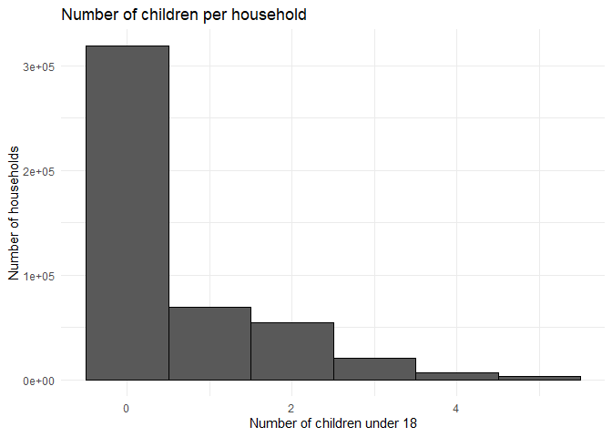

# Geog4/6300: Lab 4


- [<span class="toc-section-number">1</span> One and two sample
  difference tests](#one-and-two-sample-difference-tests)
- [<span class="toc-section-number">2</span> Assessment
  criteria](#assessment-criteria)
  - [<span class="toc-section-number">2.1</span> Loading/filtering data
    and checking for
    normality.](#loadingfiltering-data-and-checking-for-normality)
  - [<span class="toc-section-number">2.2</span> Testing the difference
    in number of
    children.](#testing-the-difference-in-number-of-children)
  - [<span class="toc-section-number">2.3</span> Identifying differences
    in time displaced by natural disasters across income
    groups](#identifying-differences-in-time-displaced-by-natural-disasters-across-income-groups)
  - [<span class="toc-section-number">2.4</span> Challenge
    Question:](#challenge-question)
  - [<span class="toc-section-number">2.5</span> Final submission
    stuff](#final-submission-stuff)

## One and two sample difference tests

**Overview:** In this lab, you’ll be doing analysis with public use
microdata from the Household Pulse survey administered by the U.S.
Census Bureau during the COVID pandemic. The survey had a particular
focus on pandemic effects on health and wellbeing, but it also included
questions on the impact of natural disasters on households. That’s the
section you’ll be focusing on here.

Unlike the aggregate census data you’re probably used to working with,
microdata provide anonymized individual-level responses that researchers
can use to calculate their own summary statistics and estimates.

There’s more info on the Pulse survey and the public use microdata file
at this link:

- [Household Pulse Survey Public Use
  Files](https://www.census.gov/programs-surveys/household-pulse-survey/data/datasets.html)

The main data are contained in the `pulse_2023` csv file in the data
folder. The data dictionary for this dataset is also available in the
data folder.

You’ll use this data to answer two research questions:

- Did households displaced by natural disasters include more children
  than those not displaced?
- Is there a relationship between household income and a household’s
  ability to return to its place of residence after being displaced?

## Assessment criteria

This lab assesses the following learning standards:

21. Assess the normality of a variable and use those results to select
    between parametric and non-parametric statistical tests.
22. Apply two-sample tests of difference and accurately interpret
    results in terms of hypothesis testing, statistical significance,
    and the direction and magnitude of any differences.
23. Construct contingency tables and apply chi-square tests to assess
    association between categorical variables, interpreting results in
    terms of significance and practical meaning.

### Loading/filtering data and checking for normality.

In the first part of the lab, you’ll be using two variables:
THHLD_NUMKID (number of children in a household) and ND_DISPLACE
(whether a household was displaced by a natural disaster in the last
year).

Load the dataset using read_csv, and also take a look at the two
variables of interest in the data dictionary. For this lab, you only
want observations with valid responses, filtering out records where
respondents did not provide an answer. Filter these data so you have
only valid responses.

**Task 1** *Load the Pulse data and filter it to only valid responses.*

``` r
# Load the original dataset
pulse <- read_csv("data/pulse_2023.csv")
```

    Rows: 539305 Columns: 48
    ── Column specification ────────────────────────────────────────────────────────
    Delimiter: ","
    chr  (2): SCRAM, EST_ST
    dbl (46): WEEK, EST_MSA, REGION, HWEIGHT, PWEIGHT, TBIRTH_YEAR, ABIRTH_YEAR,...

    ℹ Use `spec()` to retrieve the full column specification for this data.
    ℹ Specify the column types or set `show_col_types = FALSE` to quiet this message.

``` r
# Keep only valid responses
pulse_valid <- pulse %>%
  filter(THHLD_NUMKID >= 0,
         THHLD_NUMKID <= 40,
         ND_DISPLACE %in% c(1, 2))

# View the first six rows
head(pulse_valid)
```

    # A tibble: 6 × 48
      SCRAM       WEEK EST_ST EST_MSA REGION HWEIGHT PWEIGHT TBIRTH_YEAR ABIRTH_YEAR
      <chr>      <dbl> <chr>    <dbl>  <dbl>   <dbl>   <dbl>       <dbl>       <dbl>
    1 V560000001    56 06          NA      4    570.   1048.        1990           2
    2 V560000002    56 02          NA      4    247.    247.        1989           2
    3 V560000003    56 56          NA      4    620.    605.        1956           2
    4 V560000004    56 27          NA      3   1691.   4867.        1988           2
    5 V560000005    56 53          NA      4   1189.   3403.        1973           2
    6 V560000006    56 40          NA      2    642.   1199.        1978           2
    # ℹ 39 more variables: RHISPANIC <dbl>, AHISPANIC <dbl>, RRACE <dbl>,
    #   ARACE <dbl>, EEDUC <dbl>, AEDUC <dbl>, MS <dbl>, EGENID_BIRTH <dbl>,
    #   AGENID_BIRTH <dbl>, GENID_DESCRIBE <dbl>, SEXUAL_ORIENTATION <dbl>,
    #   THHLD_NUMPER <dbl>, AHHLD_NUMPER <dbl>, THHLD_NUMKID <dbl>,
    #   AHHLD_NUMKID <dbl>, THHLD_NUMADLT <dbl>, KIDS_LT5Y <dbl>, KIDS_5_11Y <dbl>,
    #   KIDS_12_17Y <dbl>, INCOME <dbl>, ND_DISPLACE <dbl>, ND_TYPE1 <dbl>,
    #   ND_TYPE2 <dbl>, ND_TYPE3 <dbl>, ND_TYPE4 <dbl>, ND_TYPE5 <dbl>, …

``` r
# Count the number of valid observations
nrow(pulse_valid)
```

    [1] 471748

You’ll be conducting a two-sample test of difference to look at whether
the number of children differs between those displaced and not
displaced. To know which test to use, you have to assess the normality
of the THHLD_NUMKID variable.

**Task 2** *Assess the normality of this variable using either a
histogram OR a qq line. Make sure your plot is visible and interpret
what it shows you about the normality of this variable.*

``` r
ggplot(pulse_valid, aes(x = THHLD_NUMKID)) +
  geom_histogram(binwidth = 1, boundary = -0.5, color = "black") +
  labs(title = "Number of children per household",
       x = "Number of children under 18",
       y = "Number of households") +
  theme_minimal()
```



### Testing the difference in number of children.

Now you can test whether the number of children differs between
displaced and non-displaced households.

**Task 3** *Based on the normality of the data, what is the appropriate
statistical test for determining whether the number of children differs
between these two groups? Explain why this test is appropriate and give
a null and alternative hypothesis for this test*

{The appropriate statistical test is the Wilcoxon rank-sum test. This is
because we are comparing two independent groups, households displaced by
natural disasters and households not displaced, and the number of
children is not normally distributed. The Wilcoxon test is a
non-parametric alternative to the independent two-sample t-test. The
null hypothesis is that there is no difference in the distribution of
the number of children between displaced and non-displaced households.
The alternative hypothesis is that a difference exists.}

**Task 4** *Run the test you identified in Task 3. Also calculate the
mean for each dataset, which you can use to determine the nature of the
difference–which group (if any) has more children.*

``` r
# Wilcoxon rank-sum test for two independent samples
wilcox_result <- wilcox.test(THHLD_NUMKID ~ ND_DISPLACE,
                            data = pulse_valid,
                            exact = FALSE)
wilcox_result
```


        Wilcoxon rank sum test with continuity correction

    data:  THHLD_NUMKID by ND_DISPLACE
    W = 1171425061, p-value = 2.463e-12
    alternative hypothesis: true location shift is not equal to 0

``` r
# Calculate the number of households, mean, and median for each group
children_summary <- pulse_valid %>%
  group_by(ND_DISPLACE) %>%
  summarise(n = n(),
            mean_children = mean(THHLD_NUMKID),
            median_children = median(THHLD_NUMKID),
            .groups = "drop")

children_summary
```

    # A tibble: 2 × 4
      ND_DISPLACE      n mean_children median_children
            <dbl>  <int>         <dbl>           <dbl>
    1           1   4784         0.747               0
    2           2 466964         0.594               0

**Task 5** *Interpret the results of the analysis you did in task 4.* \*
Do you reject the null hypothesis? Why or why not? \* Based on the test
result and the group means, what can we conclude about differences in
the number of children between these two groups?

**Answer:** The Wilcoxon rank-sum test gave a p-value of approximately
2.46 × 10⁻¹², which is less than 0.05, so I reject the null hypothesis.
The distribution of the number of childre differs significantly between
displaced and non-displaced households. The mean was 0.747 children for
displaced households and 0.594 for non-displaced households. Displaced
households reported about 0.153 more children per household on average.
The result is statistically significant, but the gap in means is small.
The Wilcoxon test compares distributions or ranks rather than testing
the means directly.

### Identifying differences in time displaced by natural disasters across income groups

In Part 2, you used a test of difference that included a continuous and
categorical variable. In this section, you’ll focus only on households
displaced by natural disasters to identify statistically significant
differences in time displaced using two categorical variables: one
placing responses into groups by income (INCOME) and the other showing
the time displaced (ND_HOWLONG).

Again, look at the data dictionary to better understand how these two
variables are structured.

**Task 6** *Reload the original, unfiltered Pulse dataset (not the one
you used in parts 1 and 2). Select only observations for households
displaced by a natural disaster using the ND_DISPLACE variable. Then
filter for records with valid responses to INCOME and ND_HOWLONG. Call
the head of the table with `kable` when done.*

``` r
# Reload the original dataset
pulse_original<-read_csv("data/pulse_2023.csv")
```

    Rows: 539305 Columns: 48
    ── Column specification ────────────────────────────────────────────────────────
    Delimiter: ","
    chr  (2): SCRAM, EST_ST
    dbl (46): WEEK, EST_MSA, REGION, HWEIGHT, PWEIGHT, TBIRTH_YEAR, ABIRTH_YEAR,...

    ℹ Use `spec()` to retrieve the full column specification for this data.
    ℹ Specify the column types or set `show_col_types = FALSE` to quiet this message.

``` r
# Select valid displaced households
pulse_displaced<-pulse_original %>%
  filter(ND_DISPLACE==1,
         INCOME %in% 1:8,
         ND_HOWLONG %in% 1:5) %>%
  select(INCOME,ND_DISPLACE,ND_HOWLONG)

knitr::kable(head(pulse_displaced))
```

| INCOME | ND_DISPLACE | ND_HOWLONG |
|-------:|------------:|-----------:|
|      3 |           1 |          1 |
|      4 |           1 |          1 |
|      4 |           1 |          5 |
|      6 |           1 |          1 |
|      8 |           1 |          1 |
|      1 |           1 |          5 |

``` r
nrow(pulse_displaced)
```

    [1] 4087

**Task 7** *Create a contingency table of responses to the ND_HOWLONG
variable by INCOME. The rows of this table should be the income groups
and the columns should be the categorical variables showing time
displaced. Call the table when you are done.*

``` r
# Rows = income groups; columns = displacement time categories
contingency<-pulse_displaced %>%
  count(INCOME,ND_HOWLONG,name="count") %>%
  pivot_wider(names_from=ND_HOWLONG,
              values_from=count,
              values_fill=0)

contingency
```

    # A tibble: 8 × 6
      INCOME   `1`   `2`   `3`   `4`   `5`
       <dbl> <int> <int> <int> <int> <int>
    1      1   286   218   115    69   179
    2      2   162   122    50    23    63
    3      3   221   135    67    32    50
    4      4   316   160    78    42    52
    5      5   219   107    54    23    33
    6      6   317   115    58    37    37
    7      7   142    54    22     8    11
    8      8   223    64    45    35    43

**Task 8** *Run a chi-square test on your contingency table to assess
whether there are statistically significant differences in displacement
time between these income groups. You’ll likely need to delete the
INCOME variable to do so.*

``` r
chisq.test(contingency %>% select(-INCOME))
```


        Pearson's Chi-squared test

    data:  contingency %>% select(-INCOME)
    X-squared = 210.51, df = 28, p-value < 2.2e-16

**Task 9** *To help with your interpretation of results, Calculate the
percentage of households within each income group that fall into
category 1 of ND_HOWLONG (“displaced less than a week”).*

``` r
# Find the percentage in category 1 (less than one week) within each income group
income_percent <- pulse_displaced %>%
  group_by(INCOME) %>%
  summarise(total = n(),
            less_than_one_week = sum(ND_HOWLONG == 1),
            percent_less_than_week = 100 * less_than_one_week / total,
            .groups = "drop")

knitr::kable(income_percent, digits = 2)
```

| INCOME | total | less_than_one_week | percent_less_than_week |
|-------:|------:|-------------------:|-----------------------:|
|      1 |   867 |                286 |                  32.99 |
|      2 |   420 |                162 |                  38.57 |
|      3 |   505 |                221 |                  43.76 |
|      4 |   648 |                316 |                  48.77 |
|      5 |   436 |                219 |                  50.23 |
|      6 |   564 |                317 |                  56.21 |
|      7 |   237 |                142 |                  59.92 |
|      8 |   410 |                223 |                  54.39 |

**Task 10** *Interpret the results of your analysis in tasks 8 and 9.*
\* Do you reject the null hypothesis based on these results and why (or
why not)? \* What do your results in Task 9 tell you about differences
in how quickly households were able to return?

**Answer:** We reject the null hypothesis that household income and
displacement duration are independent. The chi-square test produced χ2 =
210.51, df = 28, and p \< 2.2 × 10⁻¹⁶. Since the p-value is below 0.05,
the association between household income and displacement duration is
statistically significant. In the Task 9 results, the percentage of
households displaced for less than one week generally rises with income.
It was 32.99% for households earning less than \$25,000 (INCOME = 1) and
59.92% for those earning \$150,000–\$199,999 (INCOME = 7), then fell
slightly to 54.39% for those earning \$200,000 or more (INCOME = 8).
This suggests that higher-income households tended to report shorter
displacement durations, though the trend is not consistent across income
groups. The chi-square test shows an association, not that income
directly caused households to return sooner.

### Challenge Question:

Calculate and map the percentage of households reporting displacement
(ND_DISPLACE) by state. To do so, you’ll need to start with a version of
the dataset that excludes non-valid responses and then calculate the
percentage displaced by state.

Once you’ve calculated that estimate, map it out using the
`states_albers` geopackage file in the data folder. Provide a brief
description of the patterns you observe.

``` r
#Code goes here
```

### Final submission stuff

**Disclosure of assistance:** Besides class materials, what other
sources of assistance did you use while completing this lab? These can
include input from classmates, relevant material identified through web
searches (e.g., Stack Overflow), or assistance from ChatGPT or other AI
tools. How did these sources support your own learning in completing
this lab?

{I used the class lecture slides and video on normality, two-sample
tests, and chi-square tests, as well as the Household Pulse Survey data
dictionary.}

**Lab reflection:** How do you feel about the work you did on this lab?
Was it easy, moderate, or hard? What are the biggest things you learned
by completing it?

{I found this lab moderately challenging, especially when deciding which
statistical test was appropriate and understanding how to interpret the
p-values. One important thing I learned was how to assess normality
using a histogram before choosing a statistical test. I also learned how
to use the Wilcoxon rank-sum test to compare two independent groups and
how to create a contingency table and use a chi-square test to examine
relationships between categorical variables.}
